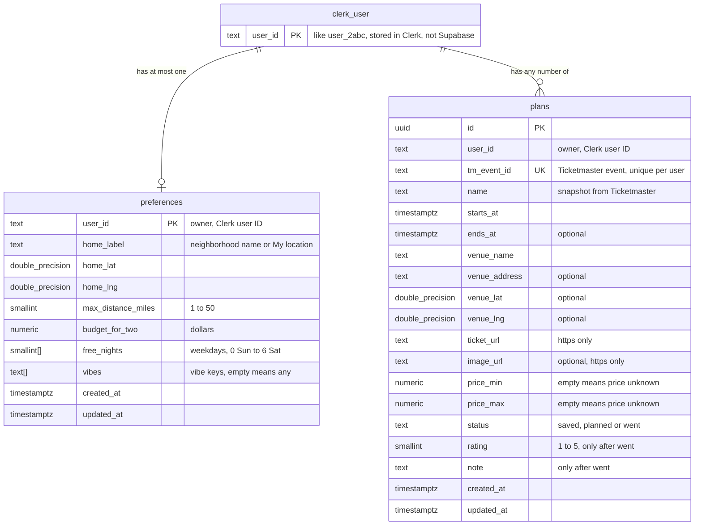

# Data model

Two Supabase tables. Every row belongs to one person, identified by their Clerk user ID. Full column rules and access policies are in the "Data model" section of [AGENTS.md](../AGENTS.md).

**Reading the lines:** `||` means exactly one, `o|` means zero or one, and `o{` means zero or more. So one person has zero or one `preferences` row and any number of `plans` rows.

## What each table holds

- **`preferences`:** how the person likes to go out: home base, how far they'll travel, budget for two, which weeknights they're free, and their vibes.
- **`plans`:** every event they've saved, with a copy of the event details taken from Ticketmaster when they saved it. `status` decides where it shows up:
  - `saved` is the shortlist.
  - `planned` is the plan.
  - `went` is history, with a rating and note.

## How a row belongs to one person

- **The person lives in Clerk, not Supabase.** Their Clerk user ID is the only link. Both tables store it in `user_id`; there's no database foreign key.
- **`user_id` is filled in automatically** from the signed-in session, so the app never sends it.
- **Row-level security** lets a person read and change only rows where `user_id` matches their session. Signed-out requests see nothing.
- **`preferences`:** `user_id` is the primary key, so each person has at most one row. There's none until they finish setup.
- **`plans`:** any number of rows per person, but each Ticketmaster event appears only once per person, and only one row can be `planned` at a time.
