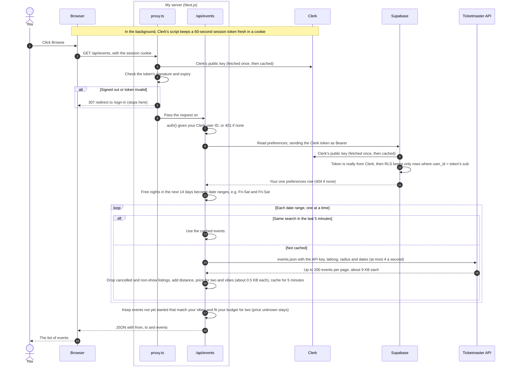

# One request, from the click to the screen

What happens when a signed-in person loads events, for example from the Browse page (not built yet), which will call `GET /api/events`.

## Who holds what

| | Holds | Never sees |
|---|---|---|
| Browser | The Clerk session cookie | Any API key, other people's data |
| My server | Clerk secret key, Supabase publishable key, Ticketmaster key (`.env.local` locally, Vercel env vars when deployed) | Passwords (Clerk handles sign-in) |
| Clerk | Accounts and sessions | Preferences, plans, events |
| Supabase | Preferences and plans, guarded by RLS | Ticketmaster key, Clerk secret key |
| Ticketmaster | The search: area, radius and dates | Who is searching |

Supabase accepts the Clerk token only after Clerk is added under Third-Party Auth in Supabase and the Supabase integration is turned on in Clerk.
